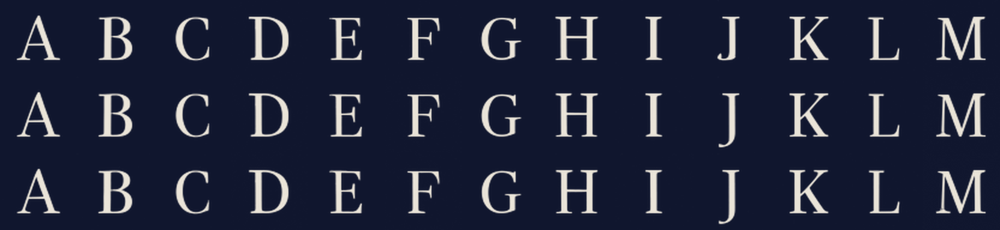
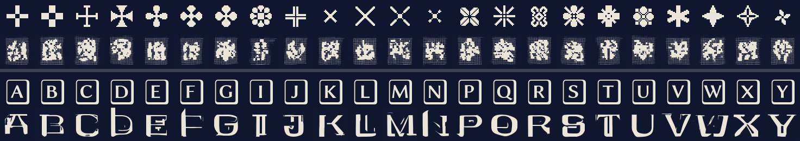

## The idea

Most people who want their own font, whether for a logo, a zine or their handwriting, give up when they see what it takes: every letter drawn and spaced by hand, then packaged into a font file. TypeFaze tries to shrink that to a few minutes. Draw **H, O, n, a and g**, and the other 47 letters are generated to match.

Everything runs on your own device. Nothing you draw is sent to a server.

## What it does

- **Draw or upload.** Sketch the five letters on a drawing pad, or upload an existing font to see what the model makes of it.
- **Get the whole alphabet.** All 52 capital and lower-case letters appear in a grid. If one comes out wrong, regenerate just that letter.
- **Try it out.** A type tester shows your font in real sentences before you commit to it.
- **Download it.** The letters are traced into outlines and packaged as an `.otf` file that installs like any other font.

## Under the hood

**A model trained from scratch.** There are two parts. A style encoder reads your five letters and sums up the style in a short list of numbers. A U-Net then draws each missing letter guided by that summary. Together they are 13.5 million parameters, small enough to download into a browser at 27 MB.

**Flow matching instead of classic diffusion.** The model learns a nearly straight path from random noise to a finished letter, so it can get there in a few big steps instead of dozens of small ones. Four steps look the same as twelve, so the site uses four.

*The same letters in 12, 6 and 4 steps, top to bottom. Fewer steps means a faster page with no visible loss.*

**Built for wobbly mouse drawings.** During training, the reference letters were randomly thickened, thinned, rotated and warped, so the model doesn't expect clean, professional outlines.

**Trained on real typefaces.** The training set is 3,518 openly licensed fonts from Google Fonts, all rendered to one shared size and baseline so the generated letters line up as a real font. They were split by family, not by file, so the fonts used for testing are designs the model has never seen in any weight. Training took 11 hours on a free Kaggle GPU.

**Runs in the browser.** ONNX Runtime Web uses the GPU through WebGPU where it can and falls back to the CPU where it can't. A small custom tracer turns the generated images into outlines, and opentype.js packages them into the font file.

## How well it works

On 131 test fonts the model had never seen, a separate letter-recognition model read TypeFaze's letters correctly **90.8%** of the time, against 91.5% for the real letters. In other words, the generated alphabet is about as legible as the real thing.

There are honest limits too. On Google Fonts, simply picking the closest existing font still matches the hidden letters slightly better, because a near-identical sans-serif almost always exists. Where generation should really matter is input no existing font resembles, like your own handwriting. That's the next thing to test.

The weakest results come from fonts that aren't really alphabets:

*Two of the worst cases. Each pair shows the real font, then TypeFaze's attempt: a font of decorative symbols, and one that draws each letter inside a keyboard key.*

## Stack

Python, PyTorch and fontTools for the data and model. ONNX Runtime Web, React, TypeScript, Vite and opentype.js for the browser app, tested with pytest and Vitest.
